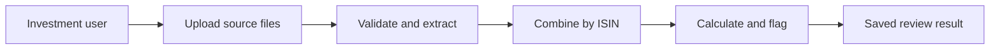

# POI Investment System

POI provides a secure, central workspace for combining investment source files into one traceable bond review. It gives investment teams a controlled way to move from fragmented holdings, broker prices, spreadsheets, and documents to a consolidated result with data-quality findings and clear analyst next steps.

## The solution

POI currently helps a team:

- Sign in securely before accessing investment data.
- Upload CSV, Excel, JSON, PDF, and text sources in one review batch.
- Preserve the original files, names, sizes, and SHA-256 checksums.
- Extract bond records and document ISIN evidence, then combine records by ISIN.
- Detect missing fields, invalid identifiers, conflicting source values, credit concerns, and issuer concentration.
- Calculate fixed-precision market values, weighted coupon, data completeness, and rating distribution.
- Save each result to an analysis history and update the central bond register.
- Produce review conditions and recommendations clearly labelled for human verification.

## How it works

1. A user signs in with their account.
2. The user uploads one or more holdings, price, quote, JSON, PDF, or text files.
3. POI stores the originals, extracts recognizable instrument data, and merges sources by ISIN.
4. The system calculates uploaded market value and completeness, surfaces conflicts and concerns, and saves the exact result.
5. The analyst reviews findings, resolves gaps, and can reopen the review from history.

## Who it is for

- Portfolio and investment teams that need a shared instrument register.
- Analysts who need one trusted place to review core bond information.
- Administrators who need to control access before adding more investment workflows.

## Current capability

| Capability | What POI provides |
| --- | --- |
| Secure access | Account sign-in with password hashing and time-limited access tokens |
| Multi-source upload | CSV, XLSX, JSON, PDF, and TXT files in batches of up to 10 |
| Evidence preservation | Immutable uploaded bytes and SHA-256 checksum metadata |
| Source consolidation | Instruments matched by ISIN with source files retained |
| Review findings | Missing, conflicting, concentration, and credit observations |
| Financial summary | Decimal-safe value, weighted coupon, quality, and rating measures |
| Review history | Stored result snapshots that can be reopened by their creator |
| Bond register | Valid instruments discovered in uploads are maintained centrally |

## Running the solution

POI runs with MySQL on the host computer and can be used either on that computer or by teammates connected to the same trusted Wi-Fi network.

1. Start MySQL on `localhost:3306`.
2. Run `start.ps1` or `start.bat` from this folder. On the first run, accept the Windows administrator prompt that adds private-subnet firewall access.
3. On this computer, open `http://localhost:5173` and sign in.
4. On another device connected to the same Wi-Fi, open the **Same Wi-Fi** URL printed by the start script. For example, this computer currently uses `http://10.67.10.26:5173`.

The Wi-Fi address can change after reconnecting, so use the URL printed each time POI starts. The Windows firewall rules allow only devices on the local subnet. This setup uses HTTP; use it only on a trusted private network. HTTPS and a reverse proxy are required before exposing POI outside that network.

For a new local database, the initial account is `admin` / `ChangeMe123!`. Change this before any shared use. Fictional example uploads are available under `samples/`.

## Configuration and operations

The application uses a Spring Boot API, React TypeScript web interface, JWT access tokens, and MySQL. Technical setup, environment variables, API routes, container use, and build commands are documented in the source folders:

- `backend-springboot/.env.example`
- `frontend-react/.env.example`
- `infrastructure/docker-compose.yml`

The default local database is `poi_investment` at `localhost:3306`. Set a strong `JWT_SECRET` and admin password before production use.
