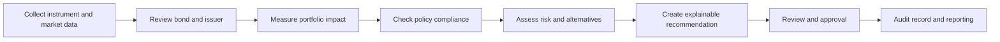

# Understanding the POI Investment System

## What this project is about

POI is an institutional investment decision and governance system focused on fixed-income instruments, especially bonds. Its purpose is to give an investment team one controlled place to understand what it owns, evaluate new opportunities, apply investment-policy rules, review risk, and preserve the evidence behind every important decision.

The central problem POI addresses is that investment information is often spread across spreadsheets, broker quotes, exchange data, information memorandums, emails, and manually prepared reports. This makes it difficult to know which data is current, whether a proposed investment follows policy, why a decision was made, and who approved it. POI is intended to turn those disconnected activities into a consistent and auditable workflow.

## The outcome POI should provide

An investment professional should be able to enter the system and answer five questions:

1. What instruments and holdings do we currently have?
2. What is each bond worth, and what market information supports that value?
3. Does the portfolio or proposed trade comply with the Investment Policy Statement?
4. What financial and concentration risks are present?
5. What evidence, calculations, explanations, and approvals led to the decision?

POI does not execute market trades. It supports analysis, control, recommendation, approval, and recordkeeping around investment decisions.

## Intended users

- Portfolio managers reviewing holdings, allocations, and investment opportunities.
- Investment analysts researching issuers and comparing bonds.
- Compliance officers checking policy limits and investigating breaches.
- Risk teams reviewing exposures, stress scenarios, and portfolio sensitivity.
- Investment Committee members reviewing recommendations and supporting evidence.
- Administrators controlling user access and maintaining trusted reference data.
- Auditors and trustees reviewing the history and integrity of decisions.

## Core solution areas

### Secure workspace

Only authenticated users should access investment information. Accounts and roles establish who may view data, add instruments, review compliance, approve changes, or administer the system. Sessions are time-limited, and sensitive actions should be attributable to a specific user.

### Instrument and bond register

POI maintains a central record for each bond. The register begins with the ISIN, issuer, coupon rate, market price, and rating, then grows into the trusted reference point for maturity details, classification, security structure, issuer information, and related documents.

### Portfolio view

The portfolio area represents what the institution owns. It should consolidate holdings, quantities, market values, allocation, income, maturity profile, duration, yield, issuer exposure, rating exposure, and other portfolio measures. It should also show the difference between the current portfolio and the desired allocation.

### Market data and broker intelligence

POI is intended to collect and standardize prices, quotes, exchange trades, ratings, news, and other market inputs. The system should retain the source and freshness of each value so users can distinguish current, stale, estimated, and manually supplied data. Market data informs decisions but does not itself decide whether an investment is allowed.

### Investment analysis and recommendations

For a bond under consideration, POI should bring together instrument details, issuer quality, pricing, relative value, liquidity, risk, policy fit, and supporting documents. The result should be an explainable recommendation rather than an unexplained score. A user should be able to see the inputs, reasoning, alternatives, and warnings behind the conclusion.

### Information Memorandum review

Information Memorandums and related issuer documents contain important financial, covenant, security, and legal information. POI is intended to ingest these documents, extract relevant facts and clauses, flag missing or risky terms, connect findings to page-level evidence, and produce a dossier suitable for analyst and Investment Committee review.

### Compliance and IPS controls

The compliance area should evaluate the portfolio and proposed investments against the institution's Investment Policy Statement. This includes concentration limits, permitted instruments, rating requirements, exposure limits, and other configurable rules. It should support pre-trade simulation, post-trade monitoring, breach tracking, controlled rule changes, and dual approval where required.

### Risk assessment

POI should calculate and explain portfolio risk separately from compliance. Expected capabilities include interest-rate sensitivity, spread sensitivity, concentration analysis, scenario testing, Value at Risk, yield-curve effects, and bond-health alerts. Risk results inform users and recommendations; they do not directly alter holdings.

### Governance, approvals, and audit evidence

Important decisions should leave a durable trail. POI is intended to record the data snapshot, policy version, calculation version, recommendation, override, approval, and explanation associated with a decision. This allows a reviewer to reconstruct what was known at the time and why the decision was accepted, rejected, or overridden.

### Reporting and oversight

The system should turn trusted portfolio, compliance, risk, and decision data into reports for investment teams, committees, trustees, and auditors. Reports should be reproducible and traceable to the underlying data rather than manually assembled without evidence.

## Typical decision flow

## Important operating principles

- POI supports investment decisions; it does not place trades.
- Market data, portfolio calculations, compliance rules, and risk models have separate responsibilities.
- Recommendations must be explainable and linked to their inputs.
- Policy overrides and sensitive changes require explicit authority and evidence.
- Every material number should have a known source, timestamp, and calculation basis.
- Historical decisions must remain reproducible even when data or policies later change.

## Current implementation status

The current working release provides the first complete decision-support workflow:

- Secure sign-in and protected sessions.
- Multi-file upload for CSV, XLSX, JSON, PDF, and TXT sources.
- Preservation of original uploaded files and their SHA-256 checksums.
- Extraction and consolidation of instrument records by ISIN.
- Fixed-precision market-value and weighted-coupon calculations.
- Data-completeness, source-conflict, rating, and issuer-concentration findings.
- Human-review recommendations and clear limitations.
- Persistent analysis results and history, plus automatic bond-register updates.
- An append-only audit event when an analysis finishes.

Full portfolio accounting, provider-driven market data, page-level document evidence and OCR, versioned IPS rules, advanced risk calculations, maker-checker approvals, decision reconstruction, and institutional report exports describe the intended product scope but are not yet fully implemented. They should be added as product features in the decision-flow order above.

## Definition of success

POI is complete when an authorized user can move from raw bond information to a documented investment decision inside one system, with portfolio impact, compliance, risk, evidence, approvals, and reporting all connected and independently reviewable.
